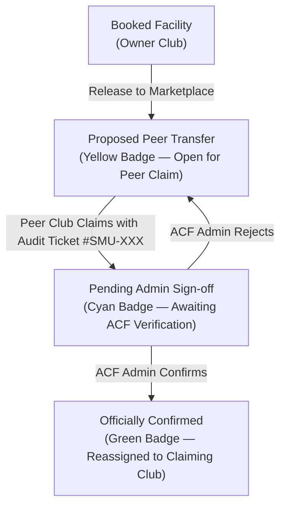

# Pulse: Integrated CCA Operations & Facility Logistics Platform

[](https://vuejs.org/)
[](https://vitejs.dev/)
[](https://supabase.com/)
[](https://getbootstrap.com/)
[](https://playwright.dev/)

> **SMU SCIS IS216 WAD2 Web Application Development II (AY26/27 SEM 1)**  
> **Section G4 · Group 13 (Supreme Emixers)**

---

## 1. Executive Summary & Problem Statement

Arts & Cultural Fraternity (ACF) and sports CCAs across Singapore Management University (SMU) rely on highly fragmented communication channels (Telegram chats, ad-hoc Google Sheets, When2Meet polls, and email chains) to schedule rehearsals, book facilities, and coordinate day-of event operations.

This fragmentation creates three operational bottlenecks:
1. **Facility Under-utilisation & Room Waste:** CCAs holding block bookings cannot easily release unused slots to peer clubs without manual administrator intervention.
2. **Scheduling Friction:** Finding overlapping availability for 20+ member rehearsal rosters requires repetitive polling and manual clash reconciliation.
3. **Day-of Event Vulnerability:** Unforeseen disruptions (weather incidents, room lockouts, member illness) lack real-time contingency routing and sandboxed alternative planning.

**Pulse** consolidates these disjointed workflows into an integrated operations platform designed specifically for university CCA executive committees and campus administrators.

---

## 2. Technical Architecture: Verified Room Exchange

Addressing university facility reservation policy (**Prof K's feedback**), Pulse enforces a **Verified Room Exchange** workflow with institutional accountability:



1. **Club-to-Club Discovery:** Clubs can only release slots they currently hold. Peer CCAs claim available slots on a first-come, first-served basis.
2. **Institutional Accountability:** Every claim generates a unique audit ticket (e.g. `#SMU-2027-089`) so campus administrators can trace room handovers back to official booking logs.
3. **Admin Verification:** The booking is only re-assigned once the campus facility administrator signs off, preventing unapproved room squatting or double-bookings.

---

## 3. Technology Stack

### Frontend & Build System
- **Framework:** Vue 3 (Composition API `<script setup>`)
- **Build Tool:** Vite 6 with Hot Module Replacement (HMR)
- **Styling & UI:** Bootstrap 5.3 + CSS
- **State Management:** Pinia (multi-club context and auth state)
- **Package Manager:** `pnpm`

### Backend & Cloud Infrastructure
- **Database:** Supabase (PostgreSQL with real-time subscriptions)
- **Role Simulation:** Multi-role switching (Club EXCO vs Facility Administrator)

### External APIs
- **OneMap Routing API:** Calculates walking and transit travel times between SMU campus buildings (e.g., SOE to SMU Hall) to inject dynamic travel buffers into day-of run-of-show timelines.
- **Cloudinary Upload API:** Handles high-resolution stage layout floorplans, event collateral, and CCA logo uploads with auto-optimization CDN delivery.
- **Google Calendar / iCal Export:** Generates standardized `.ics` calendar files enabling 1-click roster synchronization to Apple Calendar, Google Calendar, and Outlook.
- **Telegram Bot Webhook API / Web Push:** Dispatches automated event alerts and room release notifications directly to CCA group chats.

### Quality Assurance & Automated Testing
- **E2E Browser Orchestration:** Playwright (`@playwright/test`) running multi-role browser fixtures across desktop and mobile viewports.

---


## 4. Local Setup & Installation

### Prerequisites
- Node.js `v20.x` or higher
- pnpm `v9.x` or higher (`npm install -g pnpm`)
- Git

### Installation Steps

```bash
# 1. Clone repository
git clone https://github.com/sthang04/IS216-WAD2-Team-13.git
cd IS216-WAD2-Team-13

# 2. Install dependencies
pnpm install

# 3. Environment Variables
# Create a .env file in the root directory:
VITE_SUPABASE_URL=your_supabase_project_url
VITE_SUPABASE_ANON_KEY=your_supabase_anon_key

# 4. Start local development server
pnpm dev
```

The application will be accessible at `http://localhost:5173`.

---

## 5. Automated Testing

Run the automated Playwright test suite to verify end-to-end functionality:

```bash
# Run headless browser tests
pnpm test:e2e

# Run tests in interactive UI mode
pnpm test:e2e --ui
```
