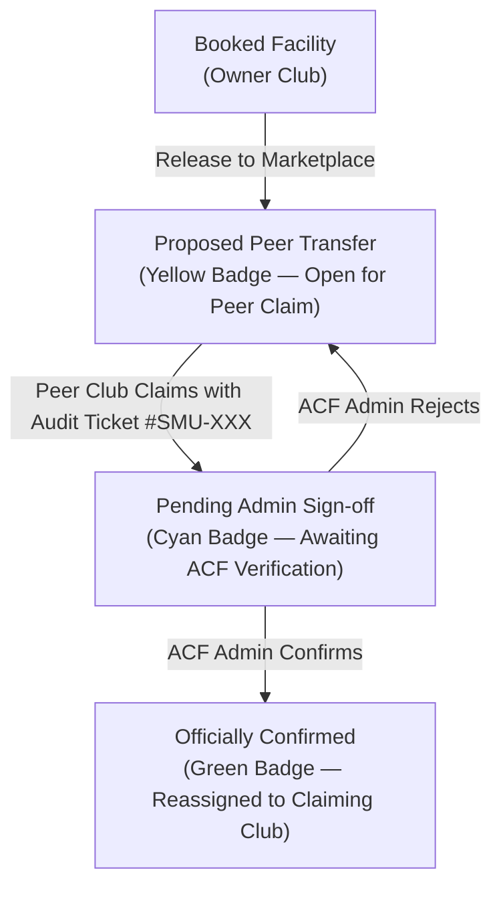

# Pulse: Integrated CCA Operations & Facility Logistics Platform

[](https://vuejs.org/)
[](https://vitejs.dev/)
[](https://supabase.com/)
[](https://getbootstrap.com/)
[](https://playwright.dev/)

> **SMU SCIS IS216 WAD2 Web Application Development II (AY26/27 SEM 1)**  
> **Section G4 · Group 13 (Supreme Emixers)**

---

## Deliverables & Quick Links

- 🌐 **Live Cloud Application:** [https://pulsewad2.com/](https://pulsewad2.com/)
- ☁️ **Backup Vercel Mirror:** [https://is-216-wad-2-team-13-git-main-pulse-497b.vercel.app/](https://is-216-wad-2-team-13-git-main-pulse-497b.vercel.app/)
- 🎬 **Pitch & Demo Video (YouTube):** [https://youtu.be/SjN0nmyNyWw](https://youtu.be/SjN0nmyNyWw)
- 📊 **Presentation Slides (Online):** [Google Slides](https://docs.google.com/presentation/d/1PpU3AIk5go4JjRHat5RdbtSLviFfBZrL/edit) · [Canva](https://www.canva.com/design/DAHZr_hzdGA/3eg4ma07b-hF90kvC9GHsQ/edit)
- 📦 **GitHub Repository:** [https://github.com/sthang04/IS216-WAD2-Team-13](https://github.com/sthang04/IS216-WAD2-Team-13)

---

## Team 13 — Supreme Emixers

| Name | SMU Email | Core Role & Responsibilities |
| --- | --- | --- |
| **Thang Sarah Adriana** | `sa.thang.2023@scis.smu.edu.sg` | **Team Lead** · Day-of Operations board, BFS downstream delay cascading, OneMap transit routing, deployment |
| **Alicia Goh Jin Bao** | `alicia.goh.2025@computing.smu.edu.sg` | User Accounts & Role-Based Access Control (RBAC), Pinia Auth Store, Telegram Bot Webhook API |
| **Angel Low Qian Hui** | `angel.low.2025@computing.smu.edu.sg` | UI/UX Lead, responsive layout architecture (mobile to desktop viewports), Design System tokens |
| **Chloe Ang Kai Qi** | `chloe.a.2025@computing.smu.edu.sg` | Backend & Supabase Schema, Facility Slot Exchange Hub, Dual-State exchange engine, Cloudinary API |
| **Giselle Goh Si Min** | `giselle.goh.2025@computing.smu.edu.sg` | Availability Heatmap grid component, academic timetable baseline pre-loading, iCalendar (.ics) export |
| **Jerica Koh Jia Xuan** | `jerica.koh.2025@computing.smu.edu.sg` | Event Planning & Risk Contingency Sandbox (Pip AI), Playwright Automated E2E Testing Suite |

---

## Evaluator Quick-Start Guide (Trying Pulse)

Best viewed on **Google Chrome**.

### Signing In
Pulse is designed with university governance: OSL pre-registers ExCo SMU emails and CCAs.
- **Option 1: 1-Click Login (Recommended for Fast Grading)**  
  On the landing page ([pulsewad2.com](https://pulsewad2.com/)), click **"Click here for 1-Click Login for different personas"** and select any persona:
  - **Rachel Tan** (`rachel.tan.2024@scis.smu.edu.sg` / `Password123!`): Eurhythmix ExCo · Logistics — Best for testing Personal Schedule, Availability Heatmap, Day-of Ops, and Event Risk (Pip).
  - **Darren Koh** (`darren.koh.2024@business.smu.edu.sg` / `Password123!`): Samba Masala ExCo · Logistics — Best for releasing / claiming facility bookings with peer clubs.
  - **Marcus Lim** (`marcus.lim.2024@socsc.smu.edu.sg` / `Password123!`): Symphonia ExCo · Marketing — Demonstrates role-based permission boundaries.
  - **Chloe Ang** (`chloe.osl@smu.edu.sg` / `Password123!`): OSL Administrator — Best for reviewing and approving/rejecting inter-club room transfer requests.
  - **Dev Administrator** (`dev.admin@smu.edu.sg` / `Password123!`): Full administrative access across all 24 CCAs.
- **Option 2: Sign Up Yourself**  
  Teaching team evaluators (`kjshim@smu.edu.sg` and `ccwong@smu.edu.sg`) or any `@*.smu.edu.sg` address can click **Sign up**, enter your email, choose your role, and set a password. Evaluators are automatically onboarded into Eurhythmix with full interactive demonstration data.

### 6 Core Evaluator User Journeys

1. **Facility Calendar & Room Exchange (Darren → Peer Club → Chloe):**
   - Sign in as **Darren Koh** → **Facilities** → open one of Samba Masala's bookings → click **Release**.
   - In an Incognito window, sign in as **Rachel Tan** (Eurhythmix) → **Facilities** → locate the released slot → click **Claim**.
   - Sign in as **Chloe Ang** (OSL Admin) → **Facilities** → **Admin** → review the claim ticket and click **Approve**.
   - Back as Darren or Rachel, observe the booking status update in real-time.

2. **Meeting Availability with Imported Timetables (Rachel):**
   - Sign in as **Rachel Tan** → **Availability**.
   - Import an academic timetable (`.ics` calendar file); class blocks render as busy automatically.
   - Create a meeting, select participant ExCos and a voting deadline, then toggle availability slots.
   - The reactive heatmap computes overlapping free times; confirm the optimal slot.

3. **Personal Schedule & OneMap Walking Clash Detection (Rachel):**
   - Sign in as **Rachel Tan** → **Personal Schedule**.
   - View scheduled Day-of Ops shifts, club events, and imported academic classes.
   - When a Day-of Ops task conflicts with an academic class or tight venue travel, Pulse flags **Clash Detected** using live walking durations calculated by the **Singapore OneMap Routing API**.

4. **Day-of Event Operations Board (Rachel):**
   - Navigate to **Day-of Ops** → open the active showcase event to view the Run of Show timeline and crew assignments.
   - Edit a task status or trigger a delay; the downstream schedule snaps and the crew is alerted.

5. **Event Risk Contingency with Pip AI (Rachel → Dev Admin):**
   - Sign in as **Rachel Tan** → **Event Risk**.
   - Select the event → select a disruption (e.g. performer illness) → select the affected member.
   - Pip analyzes impact and ranks optimal replacement candidates. Choose a recommended candidate and click **Confirm and send requests**.
   - Open an Incognito window as the replacement persona → **Personal Schedule** → **My replacement invitations** → click **Accept**.
   - Back in Pip as Rachel: click **↻ Check for replies** → click **Apply** to commit the replacement to the live Day-of Ops board.

6. **Telegram Bot Notifications (`@pulse_wad2_bot`):**
   - Click the notification bell in the navigation bar to review in-app alerts.
   - Click **Connect Telegram** to pair with [@pulse_wad2_bot](https://t.me/pulse_wad2_bot).
   - Instant real-time alerts are delivered directly to your Telegram chat for room transfers, meeting invites, and urgent schedule changes.

---

## 1. Executive Summary & Problem Statement

Arts & Cultural Fraternity (ACF) and sports CCAs across Singapore Management University (SMU) rely on highly fragmented communication channels (Telegram chats, ad-hoc Google Sheets, When2Meet polls, and email chains) to schedule rehearsals, book facilities, and coordinate day-of event operations.

This fragmentation creates three operational bottlenecks:
1. **Facility Under-utilisation & Room Waste:** CCAs holding block bookings cannot easily release unused slots to peer clubs without manual administrator intervention.
2. **Scheduling Friction:** Finding overlapping availability for 20+ member rehearsal rosters requires repetitive polling and manual clash reconciliation.
3. **Day-of Event Vulnerability:** Unforeseen disruptions (weather incidents, room lockouts, member illness) lack real-time contingency routing and sandboxed alternative planning.

**Pulse** consolidates these disjointed workflows into an integrated operations platform designed specifically for university CCA executive committees and campus administrators.

---

## 2. Technical Architecture: Verified Room Exchange

Addressing university facility reservation policy (**Prof K's feedback**), Pulse enforces a **Verified Room Exchange** workflow with institutional accountability:



1. **Club-to-Club Discovery:** Clubs can only release slots they currently hold. Peer CCAs claim available slots on a first-come, first-served basis.
2. **Institutional Accountability:** Every claim generates a unique audit ticket (e.g. `#SMU-2027-089`) so campus administrators can trace room handovers back to official booking logs.
3. **Admin Verification:** The booking is only re-assigned once the campus facility administrator signs off, preventing unapproved room squatting or double-bookings.

---

## 3. Technology Stack

### Frontend & Build System
- **Framework:** Vue 3 (Composition API `<script setup>`)
- **Build Tool:** Vite 6 with Hot Module Replacement (HMR)
- **Styling & UI:** Bootstrap 5.3 + CSS
- **State Management:** Pinia (multi-club context and auth state)
- **Package Manager:** `pnpm`

### Backend & Cloud Infrastructure
- **Database:** Supabase (PostgreSQL with real-time subscriptions)
- **Role Simulation:** Multi-role switching (Club EXCO vs Facility Administrator)

### External APIs
- **OneMap Routing API:** Calculates walking and transit travel times between SMU campus buildings (e.g., SOE to SMU Hall) to inject dynamic travel buffers into day-of run-of-show timelines.
- **Cloudinary Upload API:** Handles high-resolution stage layout floorplans, event collateral, and CCA logo uploads with auto-optimization CDN delivery.
- **Google Calendar / iCal Export:** Generates standardized `.ics` calendar files enabling 1-click roster synchronization to Apple Calendar, Google Calendar, and Outlook.
- **Telegram Bot Webhook API / Web Push:** Dispatches automated event alerts and room release notifications directly to CCA group chats.

### Quality Assurance & Automated Testing
- **E2E Browser Orchestration:** Playwright (`@playwright/test`) running multi-role browser fixtures across desktop and mobile viewports.

---


## 4. Local Setup & Installation

### Prerequisites
- Node.js `v20.x` or higher
- pnpm `v9.x` or higher (`npm install -g pnpm`)
- Git

### Installation Steps

```bash
# 1. Clone repository
git clone https://github.com/sthang04/IS216-WAD2-Team-13.git
cd IS216-WAD2-Team-13

# 2. Install dependencies
pnpm install

# 3. Environment Variables
# Create a .env file in the root directory:
VITE_SUPABASE_URL=your_supabase_project_url
VITE_SUPABASE_ANON_KEY=your_supabase_anon_key

# 4. Start local development server
pnpm dev
```

The application will be accessible at `http://localhost:5173`.

---

## 5. Automated Testing

Run the preserved browser suites with Playwright:

```bash
pnpm test:e2e # pnpm e2e is an equivalent alias
pnpm test:e2e:report
```

The default command runs application fixtures, simulator/invitation fixtures and
real-app/backend journeys. Configure the app's existing public Supabase URL/key
in .env.local for live tests. Install Chromium with
`pnpm exec playwright install chromium` if needed. The configurations share all
six required viewport sizes through `playwright.viewports.js`.

Individual commands remain available: `pnpm test:e2e:application`,
`pnpm test:e2e:simulator:fixtures`, and `pnpm test:e2e:simulator`.
Fixture-based browser results do not prove deployed database or Telegram delivery.

The two Node unit-test files and 28 non-browser Playwright contract files are kept,
with comments explaining why they exist. They are excluded from browser E2E runs.


Genuine write-workflow E2E checks now cover booking transfer/OSL approval, database write refusals and multi-user meeting scheduling on the dedicated staging backend. Configure the ignored `.env.live-e2e.local` using `.env.live-e2e.example`; this workspace is prepared. Run `pnpm test:e2e:backend`, or include them through the normal `pnpm e2e` command. Read the [workflow setup, coverage and evidence notes](e2e-backend/README.md). Schedule readability assertions and reviewed screenshot comparisons are included in the application suite.

---

## 6. Generative AI & LLM Usage Disclosure

In compliance with SMU SCIS IS216 project guidelines:
- **Permitted AI Assistance (Lower-Order Tasks):** AI assistance (LLMs) was utilized for preliminary brainstorming of user scenarios, exploration of CSS glassmorphic aesthetic concepts, boilerplate syntax scaffolding for test runners, and proofreading technical documentation.
- **Independent Team Engineering (Higher-Order Tasks):** All core application architecture, business logic (BFS downstream timeline propagation, policy-compliant dual-state facility exchange engine, OneMap transit and walking duration calculation formulas, Supabase PostgreSQL Row-Level Security policies, and Playwright multi-role browser fixtures) was authored, debugged, integrated, and verified directly by the students of Team 13.

